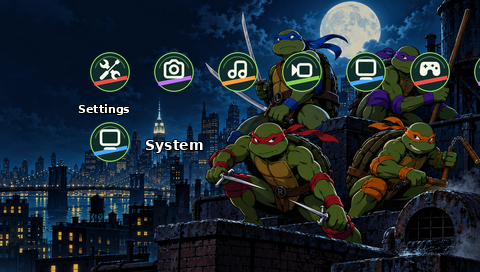
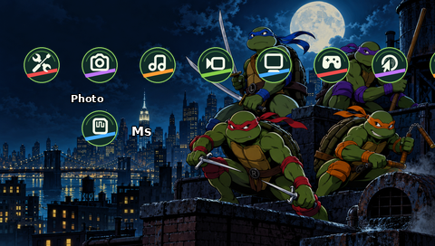
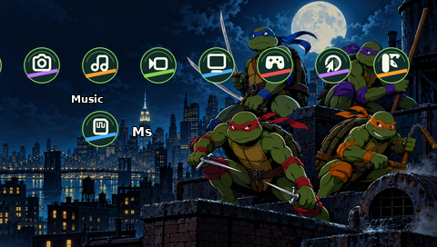
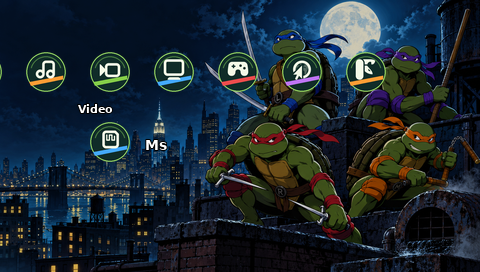
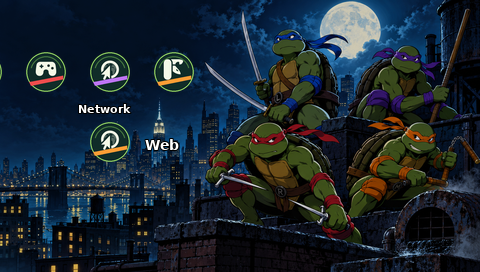
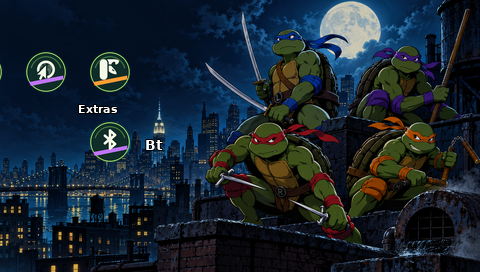
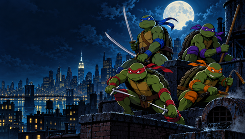

# TMNT PSP Theme

A fan-made, New York rooftop theme for the PlayStation Portable. The four mask colors animate the visual palette and custom shell badges make the XMB easier to navigate. This is an unofficial fan project, not affiliated with or endorsed by the rights holders or Sony.

[فارسی](README_FA.md) · [Download PTF](dist/TMNT_PSP_Theme.ptf) · [Validation report](docs/VALIDATION.md)


> **Testing status:** This is a candidate build, not a hardware-verified release. The previews are approximations generated from the exported artwork, not screenshots from a PSP or an emulator. Artwork has known weapon-detail inaccuracies. Please test on your device before relying on it.

## Features

- Native 480 × 272 wallpaper and a 1672 × 941 generated master illustration.
- Eight category badges, 29 first-level body icons, two second-level body icons; focus graphics based on PTF Studio's sample. Some system entries share firmware fallback icons.
- Genuine PTF binary with PTF v1 header, GIM resources and BMP wallpaper. No CTF plugin, animation or firmware modifications are included.
- Intended for PSP-1000, 2000, 3000 and PSP Go using standard PTF support. Actual model and firmware compatibility is **not verified**.

## Previews

| Settings | Photo | Music | Video |
| --- | --- | --- | --- |
|  |  |  |  |

| Game | Network | Extras | Wallpaper |
| --- | --- | --- | --- |
|  |  |  |  |

## Installation

1. Connect your PSP or its storage to a computer.
2. Copy `dist/TMNT_PSP_Theme.ptf` to `PSP/THEME/` on the memory card or PSP Go internal storage; create the folder if needed.
3. Disconnect safely. Open **Settings → Theme Settings → Theme**, and select the theme.
4. If the theme is missing or icons do not display correctly, verify the location and test without third-party theme plugins. Restore the default theme if needed.

## Build and customize

Requirements: Python 3, Pillow, DejaVu Sans Bold font (for preview labels), Node.js (validation). Run from the repository root:

```sh
python3 -m pip install Pillow
python3 tools/build.py
node tools/validate.cjs
```

Replace `assets/TMNT_wallpaper_480x272.png` with a 480 × 272 RGB PNG to change the wallpaper. Edit the palette, glyph assignments and drawing code in `tools/build.py` to customize icon exports. The `assets/symbols` SVGs and their pre-rendered PNGs are included; edit an SVG and re-render its PNG before rebuilding. Do not modify firmware-specific PTF slots without checking compatibility. The template contains the focus images; the build replaces body icons and wallpaper while preserving focus resources. The PTF Studio template and decoder are included under GPL-3.0; see their license in `vendor/`.

## Project structure

- `assets/` — wallpaper master, native wallpaper, editable SVG symbols and PNG icon exports.
- `previews/` — labeled approximations generated by the build.
- `tools/` — reproducible build and independent GIM decoding check.
- `vendor/` — PTF Studio sample and validation decoder, licenses and icon attribution.
- `dist/` — candidate compiled PTF.
- `docs/` — test results and known limitations.

## Credits and rights

Wallpaper created with OpenAI image generation for this fan project. Symbol artwork adapted from the [GNOME Project](https://www.gnome.org/) Adwaita symbolic icons under LGPL-3.0 (see `vendor/ADWAITA-COPYRIGHT.txt` and `vendor/LGPL-3.txt`). PTF template, focus resources and independent decoder from [PTF Studio](https://github.com/S1implyBlue/PTF-Studio), GPL-3.0 (`vendor/PTF-STUDIO-LICENSE.txt`). DejaVu font used for preview labels; see its distribution license. Teenage Mutant Ninja Turtles characters and related marks are property of their respective rights holders; PSP and PlayStation are Sony trademarks. No rights in those properties are granted here. The visual assets are fan art and are not licensed for commercial use by the rights holders. The code in this repository is made available under GPL-3.0; third-party assets retain their own terms.
