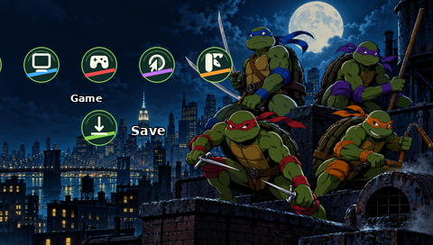

# تم لاک‌پشت‌های نینجا برای PSP

یک تم طرفداری با تصویر پشت‌بام نیویورک، رنگ‌های چهار لاک‌پشت و آیکون‌های هماهنگ برای منوی PSP. این پروژه رسمی نیست و وابستگی یا تأییدی از صاحبان اثر یا سونی ندارد.

[راهنمای انگلیسی](README.md) · [دانلود فایل PTF](dist/TMNT_PSP_Theme.ptf) · [گزارش بررسی](docs/VALIDATION.md)

**وضعیت تست:** این نسخه روی دستگاه یا شبیه‌ساز آزمایش نشده است. تصاویر، پیش‌نمایش تقریبی ساخته‌شده از دارایی‌های واقعی تم هستند و اسکرین‌شات دستگاه نیستند. برخی جزئیات سلاح‌ها در تصویر نیاز به اصلاح دارند.

## امکانات و سازگاری

- تصویر پس‌زمینه با اندازهٔ اصلی ۴۸۰ × ۲۷۲ و تصویر اصلی با وضوح بالاتر.
- هشت آیکون دسته، ۲۹ آیکون زیرمنو و دو آیکون سطح دوم؛ تصاویر حالت انتخاب از نمونهٔ PTF Studio استفاده می‌کنند.
- فایل PTF استاندارد، بدون نیاز به قالب CTF یا تغییر فایل‌های سیستم.
- برای PSP-1000، 2000، 3000 و PSP Go در نظر گرفته شده؛ سازگاری عملی با مدل و نسخهٔ سیستم‌عامل هنوز تأیید نشده است. بعضی گزینه‌های PSP Go از آیکون جایگزین استفاده می‌کنند.

## نصب

۱. PSP یا حافظهٔ آن را به کامپیوتر وصل کنید.  
۲. فایل `dist/TMNT_PSP_Theme.ptf` را در پوشهٔ `PSP/THEME/` حافظهٔ دستگاه یا کارت حافظه کپی کنید. در صورت نبود پوشه، آن را بسازید.  
۳. دستگاه را جدا کنید و از **Settings → Theme Settings → Theme** تم را انتخاب کنید.  
۴. اگر تم نمایش داده نشد، مسیر را بررسی کنید و بدون افزونه‌های تغییر تم دوباره امتحان کنید. در صورت مشکل، تم پیش‌فرض را انتخاب کنید.

## ساخت و تغییر

Python 3، کتابخانهٔ Pillow، فونت DejaVu Sans Bold برای متن پیش‌نمایش و Node.js برای بررسی لازم است. از ریشهٔ پروژه `python3 tools/build.py` و سپس `node tools/validate.cjs` را اجرا کنید. برای تغییر پس‌زمینه، فایل `assets/TMNT_wallpaper_480x272.png` را با PNG هم‌اندازه جایگزین کنید. رنگ و نماد آیکون‌ها در `tools/build.py` قابل تغییر است؛ منابع SVG و نسخه‌های PNG نمادها در `assets/symbols` قرار دارند.

پوشهٔ `assets` تصاویر و آیکون‌ها، `previews` پیش‌نمایش‌ها، `tools` ابزار ساخت و بررسی، `vendor` منابع و مجوزهای ابزارهای دیگر و `dist` فایل PTF را نگه می‌دارد.

## حقوق و منابع

تصویر اصلی با ابزار تولید تصویر OpenAI برای این پروژه ساخته شده است. نمادها از آیکون‌های Adwaita متعلق به [پروژهٔ GNOME](https://www.gnome.org/) با مجوز LGPL-3.0 اقتباس شده‌اند. قالب و ابزار رمزگشایی PTF از [PTF Studio](https://github.com/S1implyBlue/PTF-Studio) با مجوز GPL-3.0 هستند. فایل‌های مجوز در `vendor` قرار دارند. حقوق شخصیت‌ها و نشان‌های لاک‌پشت‌های نینجا و همچنین نشان‌های PSP و PlayStation متعلق به صاحبان آن‌هاست؛ این پروژه طرفداری است و مجوز تجاری از صاحبان آن آثار ندارد.

